# Viveros Tajinaste S.A. — Modelo relacional

**Asignatura:** Administración y Diseño de Bases de Datos (ULL)
**Autor/es:** _(completar)_

## Contenido del repositorio

| Fichero | Descripción |
|---|---|
| `viveros(1).drawio` | Modelo entidad/relación (draw.io) |
| `viveros(1).drawio.png` | Imagen del modelo entidad/relación |
| `modelo_relacional.png` | Diseño relacional |
| `viveros.sql` | Script SQL para PostgreSQL |
| `IMG_SELECT/` | Capturas del `SELECT` de cada tabla |

## Modelo relacional

```
VIVERO       (cod_vivero, nombre, telefono, latitud, longitud)
ZONA         (cod_vivero → VIVERO, cod_zona, tipo, latitud?, longitud?)
PRODUCTO     (cod_producto, nombre, categoria, precio)
ALMACENA     ((cod_vivero, cod_zona) → ZONA, cod_producto → PRODUCTO, stock)
EMPLEADO     (dni, nombre, apellidos, email, fecha_contratacion)
PUESTO       (dni_empleado → EMPLEADO, fecha_inicio, fecha_fin?, (cod_vivero, cod_zona) → ZONA,
              tarea, objetivo_ventas?, productividad?)
CLIENTE      (id_cliente, nombre, apellidos, email?, telefono?)
CLIENTE_PLUS (id_cliente → CLIENTE, fecha_ingreso)
PEDIDO       (num_pedido, fecha, id_cliente → CLIENTE_PLUS, dni_empleado → EMPLEADO, /importe_total)
INCLUYE      (num_pedido → PEDIDO, cod_producto → PRODUCTO, cantidad, precio_unitario, /subtotal)
BONIFICACION (id_cliente → CLIENTE_PLUS, mes, /volumen_compras, /importe)
```

`→` clave ajena · `?` admite nulos · `/` atributo derivado

### Paso del modelo E/R al relacional

- **Entidades fuertes:** una tabla por entidad, con su identificador como clave primaria.
- **Entidades débiles** (`zona`, `puesto`, `bonificacion`): la clave primaria es la clave de la entidad fuerte más el discriminante.
- **Relaciones 1:N:** la clave del lado 1 pasa como clave ajena al lado N.
- **Relaciones N:M** (`almacena`, `incluye`): tabla propia con las dos claves ajenas y los atributos de la relación.
- **Jerarquía `cliente` → `cliente_plus`:** una tabla para cada una, con la misma clave.
- **Georreferenciación:** el atributo compuesto se divide en `latitud` y `longitud`.

## Decisiones del script

- **Restricciones:** `NOT NULL` en los campos obligatorios y `CHECK` para formatos (DNI, teléfono, email), listas de valores (`tipo`, `categoria`), rangos de coordenadas y cantidades no negativas.
- **`ON DELETE CASCADE`** cuando el hijo no tiene sentido sin el padre: las zonas de un vivero, el histórico de puestos de un empleado, las líneas de un pedido, y los pedidos y bonificaciones de un cliente Plus.
- **`ON DELETE RESTRICT`** cuando hay que conservar el histórico: no se puede borrar un producto vendido, un empleado con pedidos ni una zona con puestos.
- **`ON UPDATE CASCADE`** en todas las claves ajenas, para que un cambio de código se propague.
- **Atributos derivados:**
  - `subtotal` e `importe` son columnas generadas (`GENERATED ALWAYS AS … STORED`).
  - `importe_total` y `volumen_compras` se calculan con un `UPDATE` después de insertar los datos.

## Ejemplos de `DELETE`

| Operación | Efecto |
|---|---|
| Borrar el producto `DEC-00090` | Borrado simple, sin referencias. |
| Borrar el vivero `VIV-GR06` | `CASCADE`: se borran sus zonas y su stock. |
| Borrar al empleado `46789012T` | `CASCADE`: se borra su histórico de puestos. |
| Borrar el pedido `10237` | `CASCADE`: se borran sus líneas. |
| Borrar al cliente 6 de `cliente_plus` | Deja el programa Plus, pero sigue siendo cliente. |
| Borrar al cliente 5 | `CASCADE`: se borran su registro Plus, sus pedidos, sus líneas y sus bonificaciones. |
| 3 borrados comentados al final del script | Los impide `RESTRICT` y dan error de clave ajena si se ejecutan. |

## Ejecución

```bash
sudo -u postgres psql -f viveros.sql
```

El script borra y vuelve a crear la base de datos `viveros`, crea las tablas, inserta los datos, calcula los derivados, hace los `DELETE` y termina con un `SELECT` de cada tabla.

## Salida de las tablas

Estado final de la base de datos, después de los `DELETE`.

### `vivero`

Viveros de la empresa. `VIV-GR06` no aparece porque se borra en los ejemplos de `DELETE`.

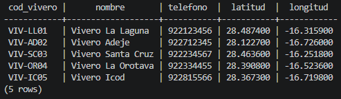

### `zona`

Entidad débil de `vivero`: su clave es `(cod_vivero, cod_zona)`. La zona `VIV-SC03/2` no tiene coordenadas.

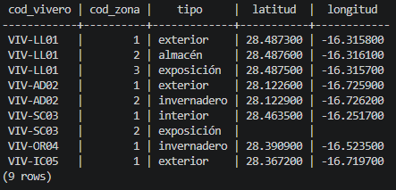

### `producto`

Catálogo de productos. `JAR-00099` tiene precio 0 (producto promocional).

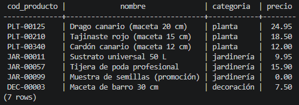

### `almacena`

Relación N:M entre `zona` y `producto`, con el `stock`. Un mismo producto puede estar en varias zonas, y hay uno agotado (stock 0).

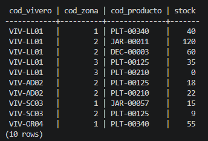

### `empleado`

Empleados de la empresa. Laura todavía no tiene puesto (recién contratada).

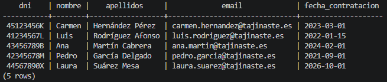

### `puesto`

Histórico de puestos de cada empleado. Una `fecha_fin` vacía indica el puesto actual, y `objetivo_ventas` solo se usa en tareas de venta.

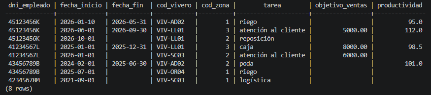

### `cliente`

Se identifica con `id_cliente` en lugar del DNI para no guardar datos personales. Algunos clientes no tienen email o teléfono.

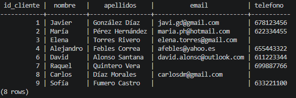

### `cliente_plus`

Clientes del programa Tajinaste Plus. Carlos y Sofía (8 y 9) no son Plus, y David (6) dejó el programa en los ejemplos de `DELETE`.

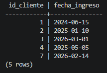

### `pedido`

`importe_total` es **derivado**: es la suma de los subtotales de las líneas del pedido.

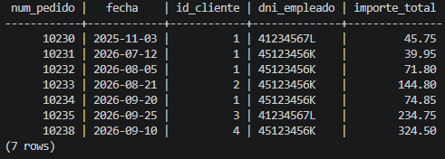

### `incluye`

Líneas de pedido (relación N:M entre `pedido` y `producto`). `subtotal` es una **columna generada** (`cantidad × precio_unitario`).

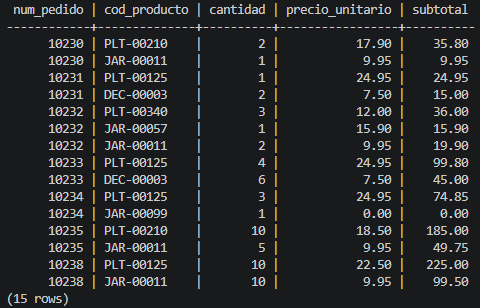

### `bonificacion`

`volumen_compras` (suma de los pedidos del mes) e `importe` son **derivados**. Tramos: 0 % si < 50 €, 3 % si < 200 € y 5 % a partir de 200 €.

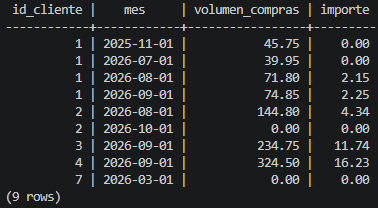